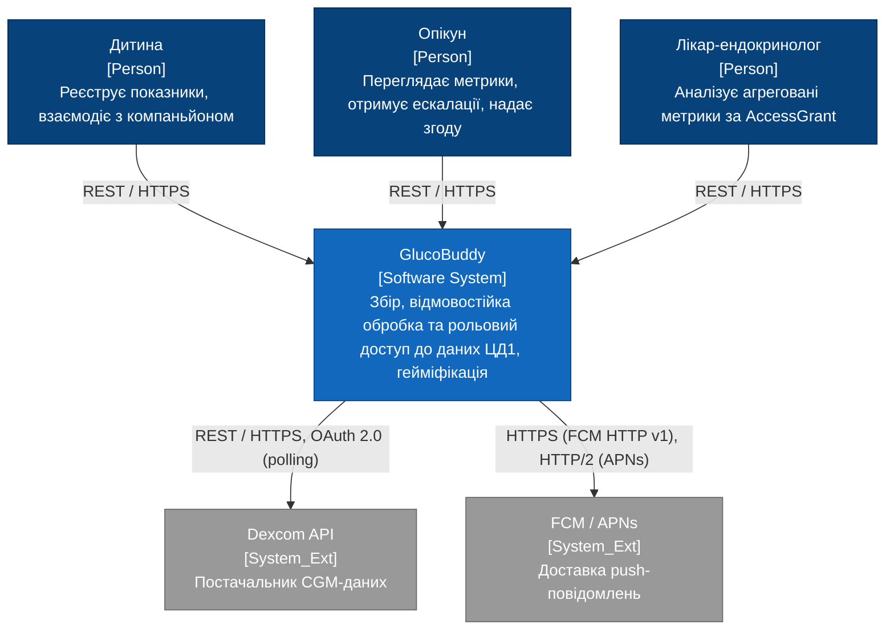
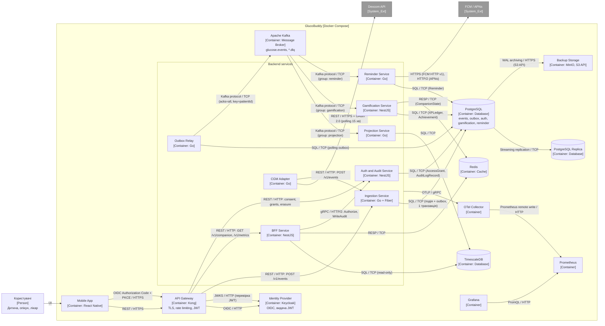
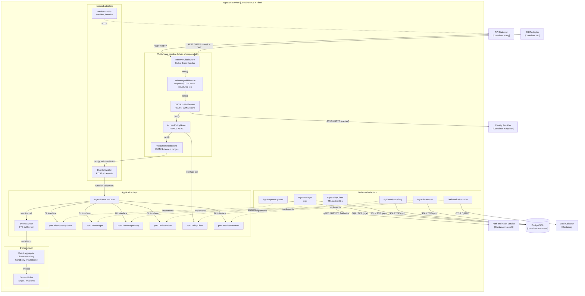

# Розділ 2. Проєктування архітектури системи

Вимоги: [SRS](./srs.md). Архітектурне рішення: [ADR-001](./adr/0001-choice-of-technology.md).

Примітка щодо синтаксису: діаграми виконано у синтаксисі `flowchart` із нотацією C4 у підписах вузлів (`[Person]`, `[System_Ext]`, `[Container: технологія]`). Це гарантує коректний рендеринг у GitHub, де нативна підтримка `C4Context` / `C4Container` є експериментальною.

## 2.1. Контекстне та контейнерне моделювання системи (C4 Model)

### C4 Level 1 — System Context Diagram

**Опис вузлів та зв'язків (L1)**

| Вузол / зв'язок | Опис | Трасування в SRS |
| --- | --- | --- |
| Дитина → GlucoBuddy, REST / HTTPS | Відправка подій показників, отримання стану компаньйона | [SRS-FUN-01](./srs.md#srs-fun-01), [SRS-FUN-12](./srs.md#srs-fun-12) |
| Опікун → GlucoBuddy, REST / HTTPS | Перегляд метрик, підтвердження згоди, прийом ескалацій | [SRS-FUN-13](./srs.md#srs-fun-13), [SRS-FUN-15](./srs.md#srs-fun-15), [SRS-FUN-20](./srs.md#srs-fun-20) |
| Лікар → GlucoBuddy, REST / HTTPS | Перегляд метрик лише за активним AccessGrant | [SRS-FUN-13](./srs.md#srs-fun-13), [SRS-FUN-17](./srs.md#srs-fun-17) |
| GlucoBuddy → Dexcom API, REST / HTTPS + OAuth 2.0 | Polling кожні 15 хв; доступ лише на читання | [SRS-FUN-19](./srs.md#srs-fun-19) |
| GlucoBuddy → FCM / APNs | Доставка нагадувань та ескалацій | [SRS-FUN-14](./srs.md#srs-fun-14), [SRS-FUN-15](./srs.md#srs-fun-15) |

### C4 Level 2 — Container Diagram

**Опис контейнерів (L2)**

| Контейнер | Технологія | Відповідальність | SRS |
| --- | --- | --- | --- |
| Mobile App | React Native | Єдиний клієнт для трьох ролей (рольовий UI) | [FUN-01](./srs.md#srs-fun-01), [FUN-12](./srs.md#srs-fun-12), [FUN-13](./srs.md#srs-fun-13) |
| API Gateway | Kong | Термінація TLS, rate limiting (sliding window, 429), перевірка JWT, маршрутизація | [NFR-SEC-01](./srs.md#srs-nfr-sec-01), [NFR-SEC-02](./srs.md#srs-nfr-sec-02), [NFR-SEC-03](./srs.md#srs-nfr-sec-03) |
| Identity Provider | Keycloak | OIDC (Authorization Code + PKCE), видача та ротація токенів, JWKS | [FUN-16](./srs.md#srs-fun-16) |
| Ingestion Service | Go, Fiber | Прийом, валідація, ідемпотентність, атомарний запис події та outbox | [FUN-01](./srs.md#srs-fun-01)–[FUN-05](./srs.md#srs-fun-05) |
| Outbox Relay | Go | Публікація outbox у Kafka з ключем `patientId` | [FUN-06](./srs.md#srs-fun-06) |
| Projection Service | Go | Часові ряди в TimescaleDB | [FUN-07](./srs.md#srs-fun-07) |
| Gamification Service | NestJS, TypeScript | XP, streak, Achievements, CompanionState у Redis | [FUN-08](./srs.md#srs-fun-08)–[FUN-11](./srs.md#srs-fun-11) |
| Reminder Service | Go | Планування, доставка та ескалація нагадувань | [FUN-14](./srs.md#srs-fun-14), [FUN-15](./srs.md#srs-fun-15) |
| BFF Service | NestJS | Агреговані read-запити для клієнта | [FUN-12](./srs.md#srs-fun-12), [FUN-13](./srs.md#srs-fun-13) |
| Auth and Audit Service | NestJS | RBAC/ABAC, згода опікуна, аудит, видалення даних | [FUN-17](./srs.md#srs-fun-17), [FUN-18](./srs.md#srs-fun-18), [FUN-20](./srs.md#srs-fun-20), [FUN-21](./srs.md#srs-fun-21) |
| CGM Adapter | Go | Polling Dexcom API і передача в Ingestion API | [FUN-19](./srs.md#srs-fun-19) |
| Apache Kafka | Kafka (KRaft) | Топік `glucose.events`, DLQ-топіки; рішення обґрунтовано в [ADR-001](./adr/0001-choice-of-technology.md) | [FUN-06](./srs.md#srs-fun-06), [NFR-REL-02](./srs.md#srs-nfr-rel-02) |
| PostgreSQL / Replica | PostgreSQL | Події, outbox, XPLedger, AccessGrant, AuditLogRecord; асинхронна репліка | [NFR-REL-03](./srs.md#srs-nfr-rel-03), [NFR-REL-04](./srs.md#srs-nfr-rel-04) |
| TimescaleDB | TimescaleDB | Read-модель часових рядів | [FUN-07](./srs.md#srs-fun-07), [FUN-13](./srs.md#srs-fun-13) |
| Redis | Redis | `CompanionState`, кеш | [FUN-11](./srs.md#srs-fun-11), [NFR-PERF-05](./srs.md#srs-nfr-perf-05) |
| Backup Storage | MinIO (S3 API) | Архів WAL та повних копій | [NFR-REL-04](./srs.md#srs-nfr-rel-04) |
| OTel Collector, Prometheus, Grafana | OpenTelemetry, Prometheus, Grafana | Трасування, метрики, дашборди | [NFR-MNT-02](./srs.md#srs-nfr-mnt-02) |

**Примітка:** усі схеми PostgreSQL (events/outbox, auth, gamification, reminder) розміщуються в одному інстансі з окремими базовими ролями доступу на сервіс; окремі інстанси перевищують ресурси стенду (4 vCPU / 8 ГБ).

**Список зв'язків та протоколів (зведення)**

| Зв'язок | Протокол |
| --- | --- |
| Mobile App → API Gateway | REST / HTTPS; OIDC (Authorization Code + PKCE) / HTTPS |
| API Gateway → Ingestion, BFF, Auth | REST / HTTP (внутрішня мережа Docker) |
| API Gateway → Keycloak | OIDC / HTTP; JWKS / HTTP |
| Ingestion, Relay, Gamification, Reminder, Auth → PostgreSQL | SQL / TCP |
| Relay → Kafka; Kafka → Projection, Gamification, Reminder | Kafka protocol / TCP |
| Projection, BFF → TimescaleDB | SQL / TCP |
| Gamification, BFF → Redis | RESP / TCP |
| BFF → Auth and Audit | gRPC / HTTP/2 |
| CGM Adapter → Dexcom API | REST / HTTPS + OAuth 2.0 |
| Reminder → FCM / APNs | HTTPS (FCM HTTP v1), HTTP/2 (APNs) |
| PostgreSQL → Replica; PostgreSQL → Backup Storage | Streaming replication / TCP; WAL archiving / HTTPS (S3 API) |
| Backend services → OTel Collector → Prometheus | OTLP / gRPC; Prometheus remote write / HTTP |

**Трасування SRS → контейнери:** усі 21 функціональна вимога має контейнер-власника (колонка «SRS» у таблиці вище); нефункціональні вимоги безпеки, надійності та спостережуваності покрито інфраструктурними контейнерами.

## 2.2. Компонентне моделювання критичного сервісу системи (C4 Component)

**Обраний сервіс:** Ingestion Service (Go + Fiber). **Обґрунтування вибору:** критичний шлях запису ([SRS-NFR-PERF-01](./srs.md#srs-nfr-perf-01): p95 ≤ 200 мс при 500 RPS); реалізує ідемпотентність ([SRS-FUN-04](./srs.md#srs-fun-04)) та атомарний запис події з outbox ([SRS-FUN-05](./srs.md#srs-fun-05)); містить найбільшу кількість інваріантів цілісності даних.

### C4 Level 3 — Component Diagram

**Технічний опис компонентів**

| Компонент | Шар | Роль та взаємодія | SRS |
| --- | --- | --- | --- |
| RecoverMiddleware | Middleware | Global Error Handler: перехоплює panic і помилки, мапить їх на HTTP-коди (422, 429, 500), не розкриває внутрішніх деталей | [NFR-SEC-05](./srs.md#srs-nfr-sec-05) |
| TelemetryMiddleware | Middleware | Генерує `requestId`, створює OTel span, пише структурований лог без PHI | [NFR-MNT-02](./srs.md#srs-nfr-mnt-02) |
| JWTAuthMiddleware | Middleware (безпека) | Верифікація JWT (RS256) за кешованим JWKS; поглиблена перевірка поверх Gateway | [FUN-16](./srs.md#srs-fun-16), [NFR-SEC-01](./srs.md#srs-nfr-sec-01) |
| AccessPolicyGuard | Middleware (безпека) | RBAC/ABAC: запис лише для власного `patientId` або за активним `AccessGrant`; викликає `PolicyClient` | [FUN-17](./srs.md#srs-fun-17) |
| ValidationMiddleware | Middleware | Валідація JSON Schema та діапазонів; повертає 422 | [FUN-02](./srs.md#srs-fun-02), [FUN-03](./srs.md#srs-fun-03) |
| EventsHandler | Inbound | REST-контролер: парсинг запиту, виклик use case, формування відповіді; не має доступу до БД | [FUN-01](./srs.md#srs-fun-01) |
| HealthHandler | Inbound | `/healthz`, `/metrics` (Prometheus) | [NFR-MNT-03](./srs.md#srs-nfr-mnt-03) |
| IngestEventUseCase | Application | Оркестрація: перевірка `Idempotency-Key` → транзакція (запис події + outbox + ключ) → метрики. Залежить лише від інтерфейсів (ports) | [FUN-04](./srs.md#srs-fun-04), [FUN-05](./srs.md#srs-fun-05) |
| EventMapper | Application | Перетворення DTO → доменна сутність; ізолює домен від формату транспорту | [FUN-01](./srs.md#srs-fun-01) |
| Ports (6 інтерфейсів) | Application | Визначені в пакеті `application`; реалізації в `adapters` (Dependency Inversion) | — |
| Event aggregate, DomainRules | Domain | Інваріанти подій (діапазони); без залежностей від Fiber та pgx | [FUN-03](./srs.md#srs-fun-03) |
| Pg* adapters | Outbound | Реалізації портів через pgx; `PgTxManager` забезпечує одну транзакцію для `EventRepository` та `OutboxWriter`; SQL / TCP | [FUN-05](./srs.md#srs-fun-05) |
| GrpcPolicyClient | Outbound | Виклик `Authorize` у Auth and Audit (gRPC / HTTP/2) з TTL-кешем 30 с | [FUN-17](./srs.md#srs-fun-17) |
| OtelMetricsRecorder | Outbound | Метрики latency/помилок (OTLP / gRPC) | [NFR-PERF-01](./srs.md#srs-nfr-perf-01) |

**Dependency Injection:** усі залежності збираються в composition root (`cmd/ingestion/main.go`) через конструкторну ін'єкцію; `IngestEventUseCase` не імпортує пакети `adapters`. **Патерни:** Chain of Responsibility (middleware), Ports and Adapters, Unit of Work (`TxManager`), Repository, Mapper. **Потік запиту:** Gateway → Recover → Telemetry → JWT → Guard → Validation → Handler → UseCase → (Idempotency, Tx[Repository + Outbox]) → PostgreSQL.

**Трасування до ADR-001:** патерн outbox у `PgOutboxWriter` базується на рішенні про Kafka як брокера, зафіксованому в [ADR-001](./adr/0001-choice-of-technology.md).

## 2.3. Документування архітектурних рішень

| ADR | Рішення | Статус |
| --- | --- | --- |
| [ADR-001](./adr/0001-choice-of-technology.md) | Вибір брокера повідомлень: Apache Kafka | Approved |

## Матриця трасування «вимога → архітектура → рішення»

| SRS | Контейнер (L2) | Компонент (L3) | ADR |
| --- | --- | --- | --- |
| [FUN-01…04](./srs.md#srs-fun-01) | Ingestion Service | EventsHandler, ValidationMiddleware, IngestEventUseCase, PgIdempotencyStore | — |
| [FUN-05](./srs.md#srs-fun-05) | Ingestion Service, PostgreSQL | PgTxManager, PgEventRepository, PgOutboxWriter | [ADR-001](./adr/0001-choice-of-technology.md) |
| [FUN-06](./srs.md#srs-fun-06) | Outbox Relay, Kafka | — (поза межами L3) | [ADR-001](./adr/0001-choice-of-technology.md) |
| [FUN-16](./srs.md#srs-fun-16), [FUN-17](./srs.md#srs-fun-17) | Keycloak, Auth and Audit | JWTAuthMiddleware, AccessPolicyGuard, GrpcPolicyClient | — |
| [NFR-SEC-03](./srs.md#srs-nfr-sec-03) | API Gateway | — | — |
| [NFR-MNT-02](./srs.md#srs-nfr-mnt-02) | OTel Collector, Prometheus, Grafana | TelemetryMiddleware, OtelMetricsRecorder | — |